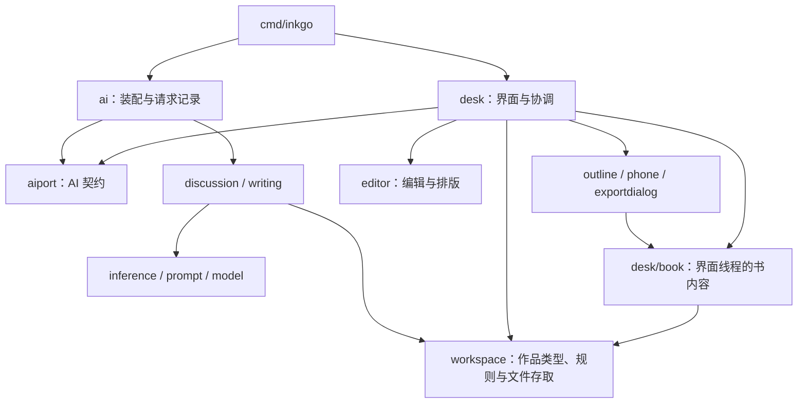

# Agent Note: 项目架构审查：让维护者容易找到、读懂和修改

Status: proposed

已实施的批次：[阅读入口、页面权限和服务表单状态](../../implemented/architecture/2026-10-27-reading-entry-and-owned-state.md)，以及 [desk 内部状态](../../implemented/architecture/2026-10-22-desk-state.md) 中的设置与记录分离、讨论轮次归属、Book 计时参数和讨论/检查/大纲文件拆分。下文保留审查时的基线和候选建议；磁盘轮询策略仍待作者评审，批注额外帧的根因仍未定位，现由串行帧测试保留原断言。

设置窗口、AI 记录与备份的状态归属继续在 [desk 内部状态](../../implemented/architecture/2026-10-22-desk-state.md) 中细化：状态分别由各功能持有，关闭设置与换书的收尾有独立入口。这沿用原决定并就地更新，不另建同义提案。

## Problem

作者希望架构清晰、不过度设计，人工容易介入和阅读，各模块及 agent 辅助文件规整。本篇是 2026-10-27 的审查结果和建议，不是已经采纳的架构规则。本次不修改运行时代码，也不改变界面、存储格式或协作门槛。

结论：现有包之间的分工总体合理，应保留。主要成本在 `desk` 包内的状态与操作链、过宽的页面权限，以及维护说明的检索和时效。下一步宜收紧这些现有边界，不宜再做一次全库搬家。

### 审查范围与基线

- 检查了包依赖、入口、编辑器边界、作品存储、Book 缓存、页面 Host、保存与后台交回路径、AI 端口与调用链，以及 AGENTS.md、DESIGN.md、本地技能、相关决策笔记和验证脚本。
- 基于 Git 跟踪文件统计：28 个 Go 包，166 个非 `*_test.go` 文件，共 34,968 行；含测试辅助包，不含测试文件、原型和本地 worktree 副本。
- `desk` 根包有 52 个非测试 Go 文件、14,149 行。`App` 有 96 个字段，443 个方法分布在 46 个文件。数量只是定位阅读负担的线索，不作为重构验收指标。
- `AGENTS.md` 46 行；`DESIGN.md` 604 行，其中前 356 行是数值 front matter；审查前共有 82 篇决策笔记。
- 修改本篇前运行 `npm run verify`：10 项检查全部通过，56.2 秒。没有改 DESIGN.md，因此未触发联网的 design lint。没有做整套原生界面人工走查，也没有重新测量大书性能。
- 下文区分已确认的结构事实和潜在维护风险。未复现的问题不称为运行时故障。

### 当前架构

下图是关键依赖方向，省略旁支工具包和部分直接依赖；箭头表示 import，不表示运行时数据流。

值得保留的安排：

- `cmd/inkgo` 负责启动、窗口和系统回调；`desk` 不直接引用发送请求的实现，通过 `aiport` 使用 AI。依赖测试已经守住这条边界。
- `editor` 不引用本项目的作品和 AI 包，编辑、排版可以独立理解和测试。不要为了目录整齐把作品规则塞进去。
- `workspace.Store` 管文件存取和校验，`desk/book.Book` 管界面线程看到的书内容，`openChapter` 管未保存编辑和外部冲突。这三份状态各有用途，不是应当随意合并的重复。
- `discussion` 和 `writing` 是不同用例，共用 `inference`、`prompt`、`model`。现有 `aiport`、`inference` 和窄用途的 `internal` 小包有明确理由，不因文件少就合并。
- 保留 `workspace` 内的纯规则和存取实现共包，文件按职责划分即可；当前没有证据支持再加一层通用 Repository、Domain、Service。
- 页面、导航、命令表已有稳定用途，原型和 Go 界面也已有联合验证。继续利用这些结构。

## Proposal

### 1. 优先收紧 Book 边界，避免“有规则、但接口仍允许绕过”

**已确认的证据：**

- [book.go](../../../../desk/book/book.go) 的 `Counts`、`Marks`、`Outlines`、`Checks` 返回内部 map；`Tree`、`Setting`、`Plan` 也包含共享指针或集合。修改返回值可以绕过 Book 的版本递增。这里是可变借用契约，并没有由返回类型实现只读。
- [book_guard_test.go](../../../../desk/book_guard_test.go) 只扫描 `desk/*.go`，且只识别形如 `a.Store.Method` 的表达式；不覆盖页面子包，也不识别 `store := a.Store; store.Method()`。
- [outline/host.go](../../../../desk/outline/host.go) 和 [phone/host.go](../../../../desk/phone/host.go) 都给页面完整 `*workspace.Store`。实际 outline 只为打开所在文件夹取 `Root()`，phone 只使用返回的路径。这两处不需要存储写权限。

**建议：** 先把 outline、phone 的 `Workspace()` 收窄为实际需要的路径访问；保留导出的真实读取需求，不为统一签名又把 Store 发回去。为 Book 的集合访问明确“借用只读，修改先复制”的契约；常用单项查找逐步用具体查询方法替代整张 map。保留必要的集合遍历，不为每帧安全深复制整本书。

守卫测试应覆盖声明要保护的生产代码范围，并用别名调用、子包调用作为负例验证。先靠收窄接口减少暴露，再补现有守卫，避免为此自建完整静态分析框架。

**收益与限度：** 后来的改动更难无意破坏缓存一致性。本次没有发现并复现“调用方修改借用集合导致界面错误”的故障；这是边界缺口，不是已确认的数据损坏。

### 2. 整理 App 的状态归属与生命周期，不按页面数量继续拆包

**已确认的证据：** [app.go](../../../../desk/app.go) 同时持有窗口回调、讨论会话、流式输出、服务编辑表单、分类表单、作品身份和各页状态。`resetView`、`leaveWork`、`work`、`finished` 也都在这里。文件名分工并不限制这些方法读写别处状态。

**建议：** 先选择依赖较少的一组，例如服务编辑表单，将其字段、初始化、取消和清理收在同一个包内具体类型中。之后再评估讨论状态。只有状态的变更和收尾也随之集中，才值得搬字段；单纯把 `a.input` 换成 `a.chat.input` 没有解决问题。

`App` 继续保留跨模块协调，写作、讨论、右栏之间的真实协作也继续显式调用。不要给每一组字段配一套接口，更不要为拆包把 `App` 重新包装成四十多个方法的 Host。这个限制沿用[上次状态重组](../../implemented/architecture/2026-10-22-desk-state.md)的取舍。

后台任务也要能在调用点看清：输入来自哪个作品，谁取消，在哪里交回，作品切换后是否仍应应用。[jobs.go](../../../../desk/jobs.go) 只排队执行闭包，不提供作品归属校验；备份在 [backup.go](../../../../desk/backup.go) 用 done 和作品检查处理，检查任务在 [checkrunner.go](../../../../desk/checkrunner.go) 随结果携带 Store。先统一这类调用契约和必要的过期结果判断，不升级成通用任务调度器。不能把现有局部检查的存在说成所有异步路径都已受到保护。

### 3. 修正技能的本地适配，让指令与可执行命令一致

**已确认的证据：**

- [笔记技能](../../../skills/write-notes-like-deepseek/SKILL.md) 列出 `npm run init-board`、`npm run bundle-board`，而 [package.json](../../../../package.json) 没有这两个入口；所述 `scripts/build-board.ts` 和 `.github/workflows/verify-notes.yml` 也不在本仓库。
- 技能及其 verification 参考仍介绍 `npx tsx`，根 AGENTS.md 和现有 npm scripts 则要求 Node 直接执行 TypeScript。[原安装决定](../../implemented/process/2026-10-07-agent-notes-gates.md) 明确只复制校验与归档脚本，不安装看板。
- 技能快速返回部分排除常规 CRUD、局部修复，随后又写所有行为改变属于非平凡；交互段还有“落笔/动手前确认”的宽泛措辞。结合上级规则可以解释，但给新 agent 留下了额外判断成本。

**建议：** 在现有技能中明确本仓库的可执行范围，命令只列实际存在的入口；上游未安装的能力删去或标为上游参考，不能写成这里可以直接运行。把笔记门槛表述成一条可操作规则：跨模块契约、持久格式、架构或难以从 diff 推知的取舍需要记录；局部直观修复不因“行为改变”四字自动新增笔记。确认只用于尚未决定的重要取舍，已授权工作不反复确认。

保留技能的模板和必要参考，不再复制一份同义“简明规则”到 AGENTS.md。`oil-ui` 继续只在视觉方向和视觉评审时启用；代码架构审查不因检查 DESIGN.md 而触发整套视觉工作流。

### 4. 补一个阅读入口，维护现行事实，不扩张规则文件

目前根目录没有 README。AGENTS.md 已经很短，不是当前主要冗余来源；它适合继续管协作流程。`desk/doc.go` 能找到文件，但人要理解全项目仍需从多篇决策记录拼接。

建议只补一个短的根 `README.md`：软件是什么、如何启动、模块分工、依赖方向、三条关键操作链的入口，以及指向现有规范的链接。不要同时增建 ARCHITECTURE.md、开发手册、模块索引等多套入口。

建议 README 给出的阅读链：

| 想理解什么 | 从哪里读起 |
| --- | --- |
| 启动与作品切换 | `cmd/inkgo/main.go` → `desk.New/Open/attach` |
| 编辑、保存与外部修改 | `editor` → `desk/opened.go`、`save.go` → `desk/book` → `workspace/prose.go` |
| 讨论和 AI 提议 | `desk/talkrun.go`、`propose.go` → `aiport` → `ai` → `discussion`；模型调用在 `model` |

各份说明维持单一分工：

| 文件 | 负责什么 | 不承载什么 |
| --- | --- | --- |
| README.md（建议新增） | 人工阅读地图与运行入口 | 新的协作禁令、完整 API 清单 |
| AGENTS.md | agent 的执行流程、验证入口、文档导航 | 视觉规则副本、历史决策全文 |
| DESIGN.md | 通用界面规范与设计数值 | 每个功能的完整需求、测试名单 |
| prototype/ | 可点击的具体界面与行为 | 真实存储和 AI 实现 |
| 包入口注释、desk/doc.go | 该包的职责和必要入口 | 另一套全项目规范 |
| .agents/notes/ | 为什么这样做、备选和状态 | 所有小改动的流水账 |
| .agents/skills/ | 按任务启用的工作方法 | 本仓库没有的工具承诺 |

DESIGN.md 的 604 行里有 356 行是机器数值，不能把总行数全算作散文冗余。它刚在 10-26 做过规则收窄，暂不建议再拆文件或建立 token 生成流水线。三处数值的同步已有检查，先沿用。

笔记真正需要的是更新当前事实。例如[少看几次磁盘](../../implemented/architecture/2026-10-13-fewer-looks-at-the-disk.md)原先省略了 `a.loadTree()` 与 Store 之间已有的 Book 层，风险段仍说“现在所有读写都在界面那条线上”，与现有后台讨论、检查和备份不符。审查时先校正事实，不把审查当成批准实施；后续作者明确接受去重与后台暂停，该篇已单独落地。`a.loadTree()` 本身仍用于主动读取，周期检查改经 `Book.PollChapter`。

### 5. 测试隔离从具体实例参数入手，保留现有验证入口

[book/timing.go](../../../../desk/book/timing.go) 的 `SaveAfter`、`CheckEvery` 是全局变量，多个测试会修改它们。[verify.ts](../../../../scripts/verify.ts) 因此用四个独立进程分担 desk 测试，而没有使用包内并行。

这是有测量依据的折中，不应马上删除。后续涉及保存和轮询时，可把这些时间参数变成具体实例的配置，并把已经显式接收 `now` 的路径接到一致的测试时间上。先迁移一条保存链，验证两个实例不同间隔互不影响，再决定是否扩大。不要引入完整时钟框架或通用依赖注入容器。

`npm run verify` 继续是唯一的全套入口；帧耗时检查继续单独运行。源码守卫用于关键边界，不给每条散文都配正则门禁。行为、存盘、取消和作品切换优先用真实行为测试验证。

### 6. 大文件按阅读任务局部拆分，优先级低于状态和边界

`desk/outline/plan.go` 1,137 行、`desk/chat.go` 1,055 行、`desk/check.go` 947 行。其中绘制、编辑动作和协调混放，定位时需要先浏览大量无关函数。

后续碰到对应功能时，可以在原包中把大纲的卡片编辑、网格和时间线，把讨论的绘制与发送动作分别收拢。具体是否拆，以“读一个操作是否少跳几个文件”为准。不要按统一行数切碎文件，不新增转发层，也不借这一步改变功能。

### 建议实施顺序

| 批次 | 范围 | 完成标准 |
| --- | --- | --- |
| A：阅读和指令 | 一个 README、技能本地命令、已发现的过时笔记事实 | 新人能从一个入口找到保存和 AI 链；命令均存在；规范没有新增副本 |
| B：权限和内容归属 | outline/phone Host、Book 借用契约、现有守卫 | 只需路径的页面不再取得 Store；明确哪些内容允许借用；别名和子包负例能暴露守卫缺口 |
| C：状态和收尾 | 先选服务表单等一组 App 状态，再评估讨论与异步归属 | 初始化、取消、切换作品和完成处理能在少数入口读完；既有行为不变 |
| D：按需整理 | 实例时间参数、大文件局部拆分 | 测试实例互不干扰；代码更容易追踪；没有为了“分层”增加中转调用 |

每批独立可审查、可回退。先做 A、B，再依据实际阅读收益决定 C、D 的范围。测试通过是必要条件，不能用文件数、字段数或包数下降代替可读性验收。

### 相关笔记当场审计

检索了 proposed、implemented、rejected 中的架构、边界、缓存、后台和规则关键词。处理如下；本篇没有把任何旧决定改成反面。

| 笔记 | 关系与处理 |
| --- | --- |
| [代码重组](../../implemented/architecture/2026-10-21-code-reorganization.md) | 已实施背景，保留；本篇不再重述七批施工计划，也不重新执行已完成项 |
| [desk 内部状态](../../implemented/architecture/2026-10-22-desk-state.md) | 部分重叠，互链；保留 Book、openChapter 和不强拆写作团的决定，提出更窄权限和局部状态收拢 |
| [笔记校验接入](../../implemented/process/2026-10-07-agent-notes-gates.md) | 部分重叠，互链；实施事实继续成立，建议让技能命令与其一致 |
| [DESIGN.md 只保留共享规则](../../implemented/process/2026-10-26-design-md-only-shared-rules.md) | 部分重叠，互链；沿用该分工，不恢复已删除的功能细节和测试名单 |
| [每条规则只说一次](../../implemented/process/2026-10-15-each-rule-said-once.md) | 支持本次建议的既有约束，保留，不另立重复规则 |
| [加快检查](../../implemented/process/2026-10-13-fast-checks.md) | 部分重叠，互链；保留进程隔离的当前决定，实例化参数只是后续候选 |
| [少看几次磁盘](../../implemented/architecture/2026-10-13-fewer-looks-at-the-disk.md) | 相关但独立决定；审查先校正事实，后续作者同意后单独实施去重与后台暂停 |
| 其他架构笔记、功能提案及 rejected 中的灵感池讨论 | 不在本次建议中被取代；无须删除、转状态或归档 |

## Alternatives considered

- **全面改成分层架构，每个功能一个包、每层一个接口。** 最强理由是边界一眼可见，也便于替换。当前下层边界已经清楚，写作与讨论又共享真实状态；再加层会增加 DTO、转发和 Host 方法，人工追踪反而更远。采用局部收窄和具体状态归属。
- **只补文档，代码保持不变。** 改动成本最低，能迅速改善上手。不能消除完整 Store 的多余权限和 App 的状态散布；因此把文档作为第一批，而非全部工作。
- **以更严格的源码扫描守住所有约定。** 不必动接口，就能快速提示违规。当前守卫已经说明文本形态与真实权限并不等同；扫描可以补充，但不能替代接口收窄，也不宜再生长为自制分析框架。
- **把设计 token 和文档都改为自动生成。** 能减少重复编辑的值。现有一致性检查已经运行，当前最明显的文档问题是过时指引和缺入口；生成器会增加一个需维护的工具链。出现反复同步失败再评估。

## Acceptance criteria

- 作者能从一个短入口找到模块责任人和保存、AI 两条关键调用链；无需先通读历史笔记。
- 保留现有 editor、workspace、aiport 边界；不新增通用事件总线、Repository 层或依赖注入框架。
- 页面仅获得实际使用的存储能力；Book 的版本更新责任和借用集合规则明确。
- 状态整理必须连同变更和收尾入口改善，不能只改字段前缀；关闭、取消、切换作品不出现旧结果污染新作品。
- 技能中本地命令可执行、参考链接可定位；不把未实现提案写成现行规则。
- 实施时运行受影响的行为测试和 `npm run verify`；界面涉及的改动按 AGENTS.md 渲染核对。此审查本身不以重新制作原型为前提。

## Risks

- 收拢 App 状态容易扩大成一次性重写；每批只选一个真实责任边界，跨功能协调仍留给 App。
- 为只读安全盲目复制 Book 的所有集合可能损害帧性能；先缩小访问面和明确借用，再按调用需要复制。
- 整理旧笔记可能丢掉当时的限制和真实备选；只更新现行事实，决定翻转另写提案，历史理由保留。
- 技能本地化后与上游更新有差异，需要在更新技能时保留本仓库适配；不要再维护第二份同义规则。
- 时间参数实例化涉及测试策略，收益尚未在本次测量；保留现有进程分片，迁移有证据再调整。
